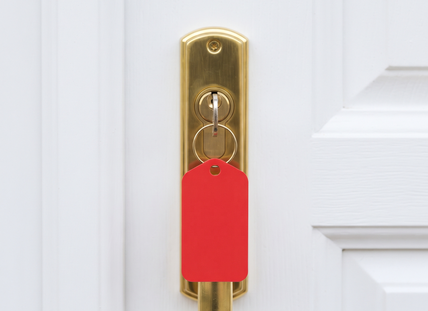

> Medium noted first: linseed oil ground on canvas stretchers, Baloo Bhaijaan 2 in print ink black, a studio inventory entry.

# cha-insecuredefaultconfigreporter

# cha-InsecureDefaultConfigReporter
Checks a YAML or JSON configuration file for two built-in default password values: the password setting set to 'password' and the admin_password setting set to 'admin'. Uses pyyaml to parse configuration files and, when the user supplies a JSON schema file, jsonschema to validate the configuration against that user supplied schema. No other built-in checks ship in this tool: it does not check ports or access controls.

## Install
`git clone https://github.com/ShadowStrikeHQ/cha-insecuredefaultconfigreporter`

> Proof sheet: Wrong Organisation, Left as Printed. The clone line above points to ShadowStrikeHQ, an organisation this repository does not belong to. The repository lives under ShadowGuard-AI. The line stands as printed, and the fault is named here rather than repaired in silence. No further install steps appear in the README, although requirements.txt in the repository names jsonschema at 4.17.0 or above and PyYAML at 6.0 or above.

## Usage
`./cha-insecuredefaultconfigreporter [params]`

> Proof sheet: the printed line names an executable the repository does not contain. The entry point is main.py, and the configuration file itself is a required positional argument that the printed line hides inside the word params. The worked shapes at the foot of main.py are a configuration with a schema, a configuration with a schema and the log level set to DEBUG, a configuration with no schema at all, and a file with a custom ending whose type is stated outright with -t yaml, using the example names config.yaml, config.json, schema.json, and config.custom.

## Parameters
- `-h`: Show help message and exit
- `-s`: Path to the JSON schema file for validation.
- `-t`: No description provided
- `-l`: No description provided

> Proof sheet: the argument the list omits. The positional config_file, path to the configuration file in YAML or JSON, is required on every run, and the README list above does not contain it. The parser in main.py gives -s, also written --schema_file, the path to the JSON schema file for validation, -t, also written --type, a choice of yaml or json with auto detection by file ending when it is not provided, and -l, also written --log_level, a choice among DEBUG, INFO, WARNING, ERROR, and CRITICAL, defaulting to INFO.

> Proof sheet: How a Run Proceeds. The configuration is loaded by file ending when no type is given, .yaml and .yml as YAML and .json as JSON, with an ending it cannot place refused in the words Could not determine the file type. Please specify with --type. When a schema file is given, a valid result is logged as Configuration is valid according to the schema. When none is given, the run warns No schema file provided. Skipping validation. The loaded configuration must be a mapping of setting names to values: an empty YAML file, which loads as None, and a JSON file that loads as a list are both refused with a plain message naming what was got instead. The two checks then run independently: a top level password equal to password logs Insecure default password detected. Please change it. and a top level admin_password equal to admin logs Insecure default admin password detected. Please change it. A file can earn both warnings in one run, and if neither matches, the run logs No default password found.

> Proof sheet: What the Check Cannot See. The comparison is for exact values at the top level only. A nested password is not seen. Password with a capital letter is not matched. admin123, changeme, and every other factory default in the world pass and produce the no default found line.

> Proof sheet: A Default Found Still Exits 0. Finding a default is a warning, not a failure: the run exits 0 either way, so anything gating on this tool exit code passes a configuration that still ships the factory password. A missing configuration file, an unparsable YAML or JSON file, a schema validation failure, and the mapping refusal all end the run at exit 1.

## License
Copyright (c) ShadowStrikeHQ

> Proof sheet: Wrong Organisation, Left as Printed. The closing line above repeats the wrong organisation and names no licence. The repository carries a separate LICENSE file headed MIT License, while the README itself names no licence at all.

